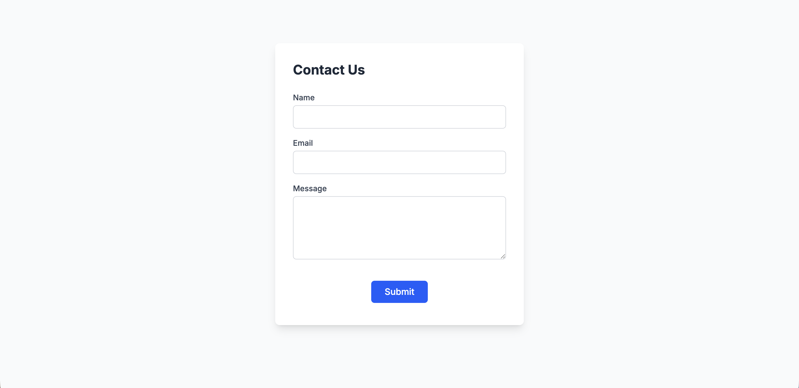
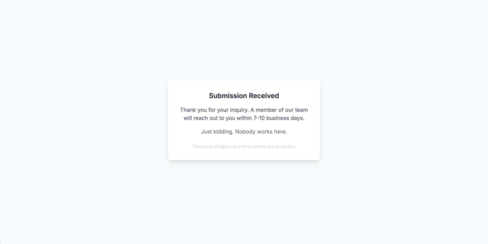

# Evasive Contact Form



A contact form where the Submit button doesn't want to be clicked.

Hover over Submit. Go ahead. Try it.

## Quick Start

```bash
git clone https://github.com/avoirol/evasive-contact-form.git
cd evasive-contact-form
npm install
npm run dev
```

## How It Works

Try to click Submit. The button dodges your cursor using spring physics — and it has opinions about the whole situation.

The longer you chase it, the more unhinged it gets:

- **Dodge 2:** *"I have boundaries."*
- **Dodge 5:** *"My therapist said I don't have to do this."*
- **Dodge 8:** *"We both know they're not going to read it."*
- **Dodge 12:** *"Plot twist: I AM the contact form."*

The button also gets progressively more panicked — faster springs, wider dodges, and it literally starts shrinking as if trying to hide.

There's a secret way to actually submit the form. You'll figure it out. Or you won't.



## Tech Stack

| Layer | Technology |
|-------|-----------|
| Framework | React 19 + TypeScript |
| Build | Vite 6 |
| Styling | Tailwind CSS v4 |
| Animation | Motion (Framer Motion) |
| Backend | None. Nobody works here. |

## What This Doesn't Have (on purpose)

- No dark mode (the corporate blandness is the bit)
- No sound effects (deadpan delivery)
- No confetti (the anticlimactic ending IS the joke)
- No AI (despite what the original AI Studio export claimed)

## Origin Story

Exported from Google AI Studio as a proof of concept. Rebuilt with escalating personality, viewport-aware dodge physics, and a deadpan easter egg ending. The original was 48 lines. This is still one component.
